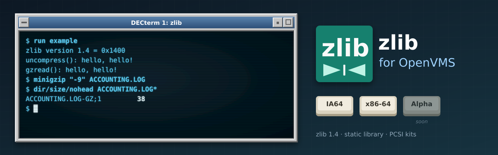

<p align="center">
  
</p>

# zlib for OpenVMS

[](https://github.com/issinoho/vms-zlib/releases/latest)
[](https://github.com/issinoho/vms-zlib/releases)

[](COPYING)

The [zlib](https://zlib.net) compression library (**1.4**) built natively for OpenVMS on **IA64**,
**x86-64**, **Alpha** and **VAX**, following zlib's own releases rather than any vendor's release cycle. Its first user
is [curl for OpenVMS](https://github.com/issinoho/vms-curl), which links it statically for
compressed transfers. It belongs to the same family as
[GNU grep](https://github.com/issinoho/vms-grep), [GNU sed](https://github.com/issinoho/vms-sed),
[GNU awk](https://github.com/issinoho/vms-awk), [GNU make](https://github.com/issinoho/vms-make),
[GNU diffutils](https://github.com/issinoho/vms-diffutils),
[GNU patch](https://github.com/issinoho/vms-patch), [GNU m4](https://github.com/issinoho/vms-m4),
[GNU Bison](https://github.com/issinoho/vms-bison), [flex](https://github.com/issinoho/vms-flex),
[GNU Wget](https://github.com/issinoho/vms-wget), [curl](https://github.com/issinoho/vms-curl),
[PCRE2](https://github.com/issinoho/vms-pcre2), [bzip2](https://github.com/issinoho/vms-bzip2),
[XZ Utils](https://github.com/issinoho/vms-xz), [Zstandard](https://github.com/issinoho/vms-zstd)
and [MariaDB](https://github.com/issinoho/vms-mariadb) for OpenVMS.

zlib ships its own OpenVMS build procedure (`make_vms.com`) in the release tarball. This
repository builds with it and holds **only our changes**: every build starts from the signed
release tarball (Mark Adler's key, pinned in `keys/`), applies our patches and adds our VMS
files in `vmsport/`.

## Status

| | IA64 (OpenVMS V8.4-2L3, VSI C 7.4) | x86-64 (OpenVMS E9.2-4, VSI C 7.7) | Alpha (OpenVMS V8.4-2L2, VSI C 7.4) | VAX (OpenVMS V7.3, Compaq C 6.4) |
|---|---|---|---|---|
| zlib version of the newest kit | 1.3.2 (1.4 to follow) | **1.4** | **1.4** | 1.3.2 (1.4 to follow) |
| Builds with upstream's `make_vms.com` | yes (1.3.2) | yes | yes | yes (1.3.2; patches 0004-0005) |
| Smoke test (zlib's `example` self-test, `minigzip` round trip) | 2/2 (1.3.2) | 2/2 | 2/2 | 2/2 (1.3.2) |
| Clang (LP64) build for programs compiled with clang (`BUILD ALL CLANG`) | n/a | builds; smoke test 2/2 | n/a | n/a |
| PCSI kit | [v1.3.2-vms1](https://github.com/issinoho/vms-zlib/releases/tag/v1.3.2-vms1): `ISSINOHO-I64VMS-ZLIB-V0103-2E1-1.PCSI` | [v1.4-vms1](https://github.com/issinoho/vms-zlib/releases/tag/v1.4-vms1): `ISSINOHO-X86VMS-ZLIB-V0104-0E1-1.PCSI` | [v1.4-vms1](https://github.com/issinoho/vms-zlib/releases/tag/v1.4-vms1): `ISSINOHO-AXPVMS-ZLIB-V0104-0E1-1.PCSI` | [v1.3.2-vms1](https://github.com/issinoho/vms-zlib/releases/tag/v1.3.2-vms1): `ISSINOHO-VMS-ZLIB-V0103-2E1-1.PCSI` |

zlib 1.4 fixes several memory-safety bugs, among them a `gzwrite()` buffer overflow
(CVE-2026-85091). The x86-64 and Alpha kits are on 1.4. The IA64 and VAX kits are still
1.3.2: the IA64 build node is unavailable for now, and the VAX is built by hand over
Telnet/FTP. Both will move to 1.4 with the same patches.

On **VAX** (no 64-bit integers and no `vsnprintf()` in its C library), file offsets are
32-bit (`off_t`) and `gzprintf()` is a stub that returns `Z_STREAM_ERROR`; everything else
works. The VAX tree was built and tested over Telnet/FTP, as the VAX has no SSH.

## Installing the kit

Download the kit for your architecture from the
[latest release](https://github.com/issinoho/vms-zlib/releases/latest) and check it against
the release's `SHA256SUMS`. A kit downloaded through a non-VMS system loses its record
format, so restore that first, then install it:

```
$ SET FILE/ATTRIBUTE=(RFM:FIX,LRL:8192,MRS:8192,RAT:NONE) ISSINOHO-*-ZLIB-V0104-0E1-1.PCSI
$ PRODUCT INSTALL ZLIB /PRODUCER=ISSINOHO /SOURCE=dev:[dir]
```

It installs `ZLIB.H`, `ZCONF.H`, `LIBZ.OLB` and `MINIGZIP.EXE` under `[ZLIB]`, the
documentation in `[ZLIB.DOC]`, and `SYS$STARTUP:ZLIB$STARTUP.COM`, which defines `ZLIB$ROOT`
(add `$ @SYS$STARTUP:ZLIB$STARTUP.COM` to `SYS$MANAGER:SYSTARTUP_VMS.COM` to define it at
every boot). Build against it with `/INCLUDE=ZLIB$ROOT:[INCLUDE]` and
`ZLIB$ROOT:[LIB]LIBZ.OLB/LIBRARY`; any `/NAMES` setting works (patch 0003).
`PRODUCT REMOVE ZLIB` removes it and deassigns `ZLIB$ROOT`. The kit's version
`V1.4-0E1` is zlib 1.4 (update 0) with our patch level as the ECO; the 1.3.2 kits are
`V1.3-2E1`, and PCSI upgrades one to the other.

## What gets built

- **`LIBZ.OLB`:** the library as an object library, for static linking.
- **A PCSI kit** (`[.KIT_<arch>]`) that installs the library, headers and `minigzip`.
- **An install tree** `[.INSTALL_<arch>]` with `[.INCLUDE]ZLIB.H, ZCONF.H` and
  `[.LIB]LIBZ.OLB`. Define the rooted logical name `ZLIB$ROOT` for it, then compile with
  `/INCLUDE=ZLIB$ROOT:[INCLUDE]` and link with `ZLIB$ROOT:[LIB]LIBZ.OLB/LIBRARY`.
- `EXAMPLE.EXE` and `MINIGZIP.EXE`, zlib's test programs, and upstream's shared image
  `LIBZSHR.EXE`.

**Clang (LP64) build (x86-64):** VSI C is ILP32 (`long` and pointers 32-bit) and VSI's
clang is LP64, so objects from the two cannot be mixed, and zlib's `uLong` and `z_stream`
differ between them. `@[.VMSPORT]BUILD ALL CLANG` (or `tools/build.sh x86 ALL CLANG`) runs
the normal build, then compiles the library sources again with clang, against the same
configured `zconf.h`, into `[.OBJ_X86_64_CLANG]` and the install tree
`[.INSTALL_X86_64_CLANG]`. Its first user is [PHP for OpenVMS](https://github.com/issinoho/vms-php)
(as vms-pcre2's clang tree serves [MariaDB](https://github.com/issinoho/vms-mariadb)).
`tools/test.sh x86 CLANG` runs the smoke test against the clang-built `example` and
`minigzip`: 2/2.

## Patches

| Patch | Purpose |
|---|---|
| 0001 | `gzguts.h`: don't define `_POSIX_C_SOURCE` on VMS. Defined after `<stdio.h>`, it makes the CRTL's `<fcntl.h>` redeclare `creat()` incompatibly, and the `gz*.c` files did not compile. |
| 0002 | `make_vms.com`: recognise OpenVMS x86-64. It took the architecture from `HW_MODEL`, which put x86-64 in the VAX range: objects were compiled without `/NAMES=AS_IS` and the shared image options file was rejected. |
| 0003 | `zlib.h`: declare the API with `#pragma names as_is` on VMS, so programs compiled with the default `/NAMES=UPPERCASE` link with the `AS_IS` library. |
| 0004 | `make_vms.com`: on VAX, define `z_off_t` as `off_t` at the top of `zconf.h`. DEC C for VAX has no 64-bit integers, and the template otherwise falls back to `long long`. |
| 0005 | `make_vms.com`: on VAX, disable two harmless warnings that stop MMS: `BADHEXCONST` (zutil.h's 64-bit type test) and `BADDIRECTIVE` (`#warning` for the `gzprintf()` stub, as the VAX C RTL has no `vsnprintf()`). |
| 0006 | `test/example.c`: on VAX, write with `gzputs()` instead of the `gzprintf()` stub, so zlib's self-test runs to the end. |
| 0007 | `make_vms.com`: define `z_off_t` as `long long` on Alpha, IA64 and x86-64. zlib 1.4 changed `zconf.h`'s last-resort `z_off_t` from `long long` to `long`, which VMS always takes and which is 32 bits in VSI C, so `gzseek()`/`gztell()` would have been limited to 2 GB and `z_off_t` would no longer match programs built against 1.3.x. It stays 8 bytes, as in 1.3.2. |

All of them apply to upstream's VMS support and could go back to zlib.

## How to build

```sh
git clone https://github.com/issinoho/vms-zlib.git
cd vms-zlib
tools/prepare.sh            # fetch + verify the release, apply patches, add vmsport/
tools/build.sh ia64         # upload, then @[.VMSPORT]BUILD on the node (upstream's make_vms.com)
tools/test.sh ia64          # smoke test
```

By hand on VMS: copy the top-level files of `staging/zlib-1.4/` and its `vmsport/` and
`test/` directories, then `@[.VMSPORT]BUILD` and `@[.VMSPORT]TEST_SMOKE`. Set up
`tools/nodes.conf` as described in
[vms-grep's README](https://github.com/issinoho/vms-grep#2b-build-on-vms-from-the-host-over-ssh).

## Roadmap

1. ~~curl for OpenVMS links this library statically~~: done in
   [vms-curl v8.22.0-vms1](https://github.com/issinoho/vms-curl/releases/tag/v8.22.0-vms1);
   [vms-wget](https://github.com/issinoho/vms-wget) links it too.
2. Patches 0001-0003 and 0007 offered to zlib.
3. ~~A port to OpenVMS **Alpha**.~~ Done: see Status (Alpha and VAX kits).

## The family

This port is one of a family of ports and tools for OpenVMS, each following its upstream
releases. [openvms.issinoho.com](https://openvms.issinoho.com) lists them all, with the
newest kit for each architecture taken from their GitHub releases.

## Artwork

`docs/images/banner.svg` and `docs/images/icon.svg` were made for this project in the style
of classic DECwindows and VT terminals, like those of its sibling ports. The "zlib" mark in
them is our own drawing, not an official zlib logo.

## Licence

zlib is distributed under the zlib licence; see `COPYING`, a copy of upstream's `LICENSE`.
Our patches and VMS build files are distributed under the same terms.

OpenVMS is a trademark of VMS Software, Inc. This project is not affiliated with VMS
Software, Inc. or with the zlib project.
